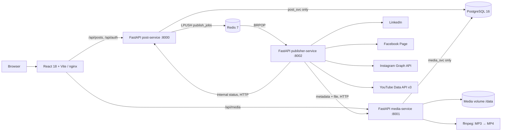

# SocialSync

**One post. Every platform.** SocialSync is a university DevOps project demonstrating containerized microservices, independent database schemas, asynchronous publishing, Docker Compose, Kubernetes, and CI. Upload a PNG, MP4, or MP3, write a caption, and send it to LinkedIn, a Facebook Page, Instagram, and YouTube. Simulation is on by default; no social accounts are needed to try it.

## Architecture



- **frontend** — React/TypeScript, Tailwind and React Query. nginx serves the built SPA and routes API calls; the browser never receives service credentials.
- **post-service** — JWT admin login, posts and target records, queueing, status and retries. It uses the `post_svc` schema only.
- **media-service** — validates the declared MIME type and magic bytes, stores originals, converts MP3 to MP4 with ffmpeg and a bundled cover, and supports HTTP range requests. It uses the `media_svc` schema only. Media file URLs are intentionally public so Instagram can fetch them; do not upload confidential files.
- **publisher-service** — consumes one job per target, validates platform rules, fetches media via HTTP, and invokes adapters. Transient failures retry three times with exponential backoff. `/metrics` exposes Prometheus counters and a duration histogram. JSON logs include the propagated `X-Request-ID`.
- **PostgreSQL / Redis** — PostgreSQL roles own only their respective schemas; Redis carries the `publish_jobs` list. The migration job needs PostgreSQL access as a one-shot exception to the database network policy.

## Run with Docker Compose

Requirements: Docker Engine and Docker Compose v2. From the repository root:

```sh
docker compose up --build
```

Open <http://localhost:8080>. With no `.env` file, the **disposable local-only** login is `admin` / `socialsync-local-admin`, and all publishing is simulated. Compose supplies clearly marked development defaults so a fresh clone runs immediately. For anything beyond a local demonstration, copy `.env.example` to `.env`, change every password, JWT secret and internal key, and keep the file private. Use URL-safe alphanumeric DB passwords, because Compose interpolates them into database connection URLs. `.env` is git-ignored.

```sh
cp .env.example .env
# Change the example credentials before using outside your own machine.
docker compose up --build -d
docker compose logs -f
make test
make down
```

The first start creates the two database roles/schemas from `db/init.sql`, then each service runs its own Alembic migration. Named volumes persist PostgreSQL, Redis, and uploaded media. `docker compose down -v` **deletes all data**. To use the opt-in hot-reload services, run `docker compose --profile dev up --build frontend-dev post-service-dev media-service-dev`; the Vite UI is at port 5173. The dev frontend proxies to the normal backend services; the additional backend reload instances expose ports 8003 and 8004 for direct development.

### Workflow

1. Sign in with the configured `ADMIN_USER` and `ADMIN_PASSWORD`.
2. Choose a PNG, MP4, or MP3 (up to `MAX_UPLOAD_MB`, 200 MB by default), enter a title and caption, and select channels.
3. Publish. MP3 is converted to an MP4 with the included still image. YouTube requires video (or converted audio); Instagram supports PNG or MP4 Reels. Caption limits are checked on the client and worker.
4. Open **Post history** to watch each target. Pending/processing posts refresh every three seconds. Failed targets can be retried individually. A dry-run failure is deliberately simulated occasionally to demonstrate retries.

For a production system, use TLS, managed secrets, scoped platform credentials, durable message acknowledgement/dead-letter handling, a shared object store, token refresh, and rate limiting. The sample Redis list removes an item on `BRPOP`; a worker crash during a job can lose that in-flight job. Publishing and status updates are not atomic across external APIs, so a retry after a platform accepted a post can create duplicates. These are intentional demo limitations, not exactly-once guarantees.

## Kubernetes: kind or minikube

The plain manifests under `k8s/` use namespace `socialsync`, a Postgres StatefulSet/PVC, Redis, one RWO media PVC, health probes, a migration Job, a publisher CPU HPA, an nginx Ingress, and ingress network policies. App containers wait for the migration tables before starting. Build the images with `docker compose build` first.

For **kind** (with an existing cluster):

```sh
docker compose build
kind load docker-image socialsync-post:local socialsync-media:local socialsync-publisher:local socialsync-frontend:local --name kind
kubectl apply -k k8s/
kubectl -n socialsync wait --for=condition=complete job/socialsync-migrations --timeout=240s
kubectl -n socialsync get pods,svc,pvc,hpa
kubectl -n socialsync port-forward svc/frontend 8080:8080
```

Open <http://localhost:8080> through the port-forward. For **minikube**, use `minikube start`, `minikube image load` for each of the four image names, `minikube addons enable ingress`, then `kubectl apply -k k8s/`. Add `$(minikube ip) socialsync.local` to your hosts file and visit `http://socialsync.local`. For kind ingress, install ingress-nginx and configure the cluster's ingress port mappings, then map `socialsync.local` to localhost. HPA requires metrics-server; NetworkPolicy enforcement requires a CNI that implements it (kind's default networking may not enforce policies).

`secret.example.yaml` contains **only disposable demo values** so `kubectl apply -k k8s/` works locally. Do not put real credentials in it. For a real environment, remove it from the kustomization, create `socialsync-secrets` through your secret manager or `kubectl create secret`, update ConfigMap values, use trusted images, and apply your own TLS and storage policies. Re-run migrations after an upgrade by deleting/recreating the completed Job. `make k8s-deploy` and `make k8s-delete` wrap apply/delete; PVCs from the StatefulSet may need explicit removal.

## Enable real platform APIs

Set `DRY_RUN=false` globally, or override a single platform using `LINKEDIN_DRY_RUN=false`, `FACEBOOK_DRY_RUN=false`, `INSTAGRAM_DRY_RUN=false`, or `YOUTUBE_DRY_RUN=false`. An empty override inherits the global setting. Configure these server-side variables in `.env` or a Kubernetes Secret:

- **LinkedIn:** `LINKEDIN_ACCESS_TOKEN`, `LINKEDIN_AUTHOR_URN`, and an actively supported `LINKEDIN_API_VERSION`. Obtain the relevant member/organization publishing permissions. The adapter initializes and uploads an image/video, finalizes video parts, then uses the Posts API.
- **Facebook Page:** `FACEBOOK_PAGE_ID` and `FACEBOOK_PAGE_ACCESS_TOKEN` with Page publishing permissions. The adapter uses the Graph API Page photos/videos endpoints.
- **Instagram:** `INSTAGRAM_USER_ID`, `INSTAGRAM_ACCESS_TOKEN`, and `PUBLIC_MEDIA_BASE_URL` (a public HTTPS URL ending in `/api/media`). Use a professional account with content-publishing permissions; Meta fetches the media URL itself. The adapter creates a media container, polls readiness, and publishes it. For an Instagram image, the media service provides an on-demand JPEG variant because the Instagram publishing API does not accept PNG. Media must also satisfy Meta's size, duration, aspect-ratio, and codec requirements.
- **YouTube:** `YOUTUBE_ACCESS_TOKEN` with the `youtube.upload` OAuth scope and optionally `YOUTUBE_PRIVACY_STATUS`. The adapter starts a Data API v3 resumable upload and sends the MP4 to the returned upload URL. This demo reads an access token directly; rotate it externally when it expires.

Consult current platform documentation and app-review requirements before enabling real publishing. API versions, token scopes, rate limits, and access policies may change. Never put tokens in the browser bundle or commit them to git.

## API and operations

`POST /auth/login`, `POST /posts`, `GET /posts`, `GET /posts/{id}`, and `POST /posts/{id}/targets/{platform}/retry` are exposed through `/api` on nginx. Upload with `POST /api/media` as multipart field `file`; `/api/media/{id}/file` supports byte ranges, `?variant=original`, and an Instagram-compatible JPEG image via `?variant=instagram`. Deletion requires a JWT. The internal status PATCH is not exposed by nginx and requires `X-Internal-API-Key`.

Each service has `/health`; the post and media services have `/ready`, and the publisher provides `/ready` and `/metrics`. Requests accept and return `X-Request-ID`, which is also passed to downstream service calls and included in structured JSON logs. CI runs Ruff, pytest, ESLint, Vitest, frontend builds, Docker image builds, and pushes to GHCR on `main`.

## Troubleshooting

- **Can't log in:** verify `ADMIN_USER`, `ADMIN_PASSWORD` and shared `JWT_SECRET`; restart affected containers after changing environment values.
- **Startup/migrations fail:** inspect `docker compose logs postgres post-service media-service`. Init scripts run only on a fresh Postgres volume. A changed DB password needs a role update or a fresh local volume. On Kubernetes inspect `kubectl -n socialsync logs job/socialsync-migrations -c create-schemas` and each migration init container.
- **Media rejected:** the extension, MIME type and magic bytes must match; a renamed file is not enough. Check size and ffmpeg logs for malformed MP3s.
- **A target fails:** check its error in history, service logs and platform permissions. PNG is not accepted by YouTube. For Instagram, verify the file URL is publicly reachable via HTTPS and meets Meta's media specs.
- **HPA shows unknown or policies appear ineffective:** install metrics-server and use a NetworkPolicy-capable CNI.
- **Reset local demo:** `docker compose down -v` removes all local database, queue, and media volumes.

The hosted preview in this development environment uses a small Next.js/Drizzle demonstration adapter for the same interface; it is separate from the requested Compose/Kubernetes deployment and simulates publishing locally. It does not transcode audio or perform real platform publishing. The standalone project is the Vite + FastAPI stack described above.
